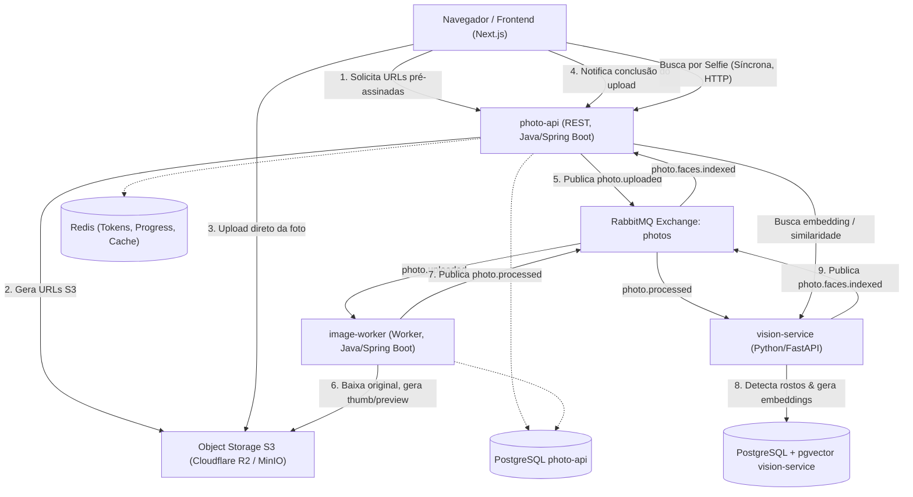

# Arquitetura do Agnitio

O **Agnitio** é uma plataforma distribuída para processamento, gerenciamento e recuperação inteligente de fotos de eventos esportivos e sociais.

## Visão Geral da Solução

## Princípios de Arquitetura

1. **Separação de Dados por Serviço**:
   - `photo-api` e `vision-service` são autônomos e possuem schemas/bancos de dados isolados.
   - O `vision-service` não acessa o banco da `photo-api`, e vice-versa.
   - A correlação entre os serviços é mantida através dos identificadores imutáveis (`eventId`, `photoId`).

2. **Clean Architecture no Backend Java**:
   - `domain`: Java puro (sem Spring, JPA, Jackson, AWS SDK).
   - `application`: Casos de uso e portas de entrada e saída.
   - `infrastructure`: Adaptadores técnicos para bancos, filas, storage e controllers.
   - `photo-api` / `image-worker`: Bootstraps Spring Boot.
   - `architecture-tests`: Testes ArchUnit que quebram o build caso as regras sejam violadas.

3. **Comunicação Híbrida (Event-Driven vs. Síncrono)**:
   - **Assíncrona (RabbitMQ)**: Para processamento pesado de fotos (redimensionamento, marca d'água, extração EXIF e indexação facial).
   - **Síncrona (HTTP REST interno)**: Para a busca facial por selfie, onde o participante aguarda ativamente a resposta na interface.

4. **Privacidade e LGPD**:
   - Consentimento explícito obrigatório antes da captura da selfie.
   - Embeddings de selfies nunca são persistidos em disco ou banco (descarte imediato após a consulta).
   - TTL e retenção configurável por evento para dados biométricos.
